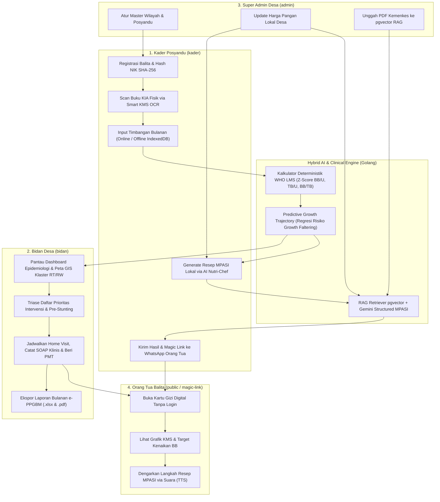

# Dokumentasi Spesifikasi Fitur Lengkap: Tumbuhin
**Smart Posyandu & Clinical AI Ecosystem (Stunting Early-Warning System)**

Dokumen ini disusun dari perspektif **Project Manager** sebagai cetak biru (*master blueprint*) fungsionalitas aplikasi **Tumbuhin** secara menyeluruh (100% komplit). Seluruh modul, struktur navigasi *sidebar*, alur kerja lintas peran, parameter input/output, integrasi *Hybrid AI*, hingga mekanisme *Offline-First PWA* didefinisikan secara presisi untuk ke-4 role pengguna.

---

## 1. Arsitektur Role-Based Access Control (RBAC) & Cakupan Data

Sistem menerapkan isolasi akses berbasis peran dan batasan wilayah (*Row-Level Scoping*) untuk menjaga kerahasiaan medis sesuai regulasi perlindungan data kesehatan:

| No | Nama Role | Kode Sistem | Cakupan Data (*Data Scope*) | Metode Autentikasi | Perangkat Utama |
| :--- | :--- | :--- | :--- | :--- | :--- |
| **1** | **Petugas Posyandu** | `kader` | Terbatas pada 1 Unit Posyandu / RW tugasnya (`posyandu_id`) | Login No. HP / Email + Password (JWT / Supabase Auth) | Smartphone Android / Tablet (*Mobile-First PWA*) |
| **2** | **Bidan Desa / Tenaga Gizi** | `bidan` | Agregasi seluruh Posyandu dalam 1 Desa / Wilayah Puskesmas (`village_name`) | Login Email / NIK Nakes + Password (JWT / Supabase Auth) | Laptop / Tablet / Desktop |
| **3** | **Super Admin Desa / Sistem** | `admin` | Akses penuh tingkat Desa & konfigurasi *Knowledge Base* AI global | Login Email Admin + Password (JWT / Supabase Auth) | Desktop / Laptop |
| **4** | **Orang Tua Balita** | `public` (*Magic Link*) | Hanya 1 profil balita miliknya (*Read-Only*) | Token Enkripsi 64-Karakter (`magic_token`) via WhatsApp tanpa login | Smartphone (*Mobile Web + TTS*) |

---

## 2. Diagram Alur Integrasi Lintas Role (End-to-End Workflow)

---

## 3. Rincian Struktur Sidebar & Fitur Lengkap per Role

### ROLE 1: PETUGAS POSYANDU (`kader`)
**Fokus Utama:** Kecepatan pencatatan di meja layanan Posyandu, kemudahan pemindaian Buku KIA lama, edukasi gizi berbasis anggaran keluarga, serta ketahanan operasional tanpa sinyal internet (*Offline-First*).

#### Struktur Menu Sidebar / Navigasi Petugas Posyandu
1. **Beranda Posyandu** (`/kader/dashboard`)
2. **Data & Profil Balita** (`/kader/balita`)
3. **Input Timbangan & Z-Score** (`/kader/timbang`)
4. **Smart KMS OCR (Scan KIA)** (`/kader/ocr-kms`)
5. **AI Nutri-Chef (Resep MPASI)** (`/kader/nutri-chef`)
6. **Antrean Sinkronisasi Offline** (`/kader/sinkronisasi`)
7. **Distribusi WhatsApp & Magic Link** (`/kader/distribusi`)

---

#### Detail Fungsionalitas Tiap Menu Sidebar Kader

##### 1.1. Beranda Posyandu (`/kader/dashboard`)
* **Kartu Ringkasan Hari Buka Posyandu:**
  * Total balita terdaftar di unit Posyandu tersebut.
  * Jumlah balita yang sudah ditimbang bulan berjalan vs belum hadir (persentase kehadiran).
  * Jumlah balita dengan peringatan dini *Growth Faltering* (tren pelambatan tumbuh) yang butuh perhatian khusus.
* **Indikator Status Jaringan & PWA:**
  * Badge status real-time: `Online (Tersinkron ke Cloud)` atau `Mode Offline Aktif (Tersimpan di Perangkat)`.
  * Jumlah data timbangan di dalam antrean lokal `IndexedDB` yang menunggu koneksi internet.
* **Pintasan Aksi Cepat (*Quick Actions*):**
  * Tombol `+ Input Timbangan Baru`, `Scan Foto Buku KIA`, `Tambah Balita Baru`, dan `Buat Resep MPASI`.
* **Daftar Instruksi Balik dari Bidan Desa:**
  * Notifikasi tugas tindak lanjut dari Bidan (contoh: *"Tolong ingatkan Ibu dari Balita Andi untuk hadir pengambilan PMT hari Jumat"*).

##### 1.2. Data & Profil Balita (`/kader/balita`)
* **Direktori & Pencarian Balita:**
  * Pencarian instan berdasarkan nama balita atau nama orang tua.
  * Filter berdasarkan RT/RW, kelompok usia (`0-6 bln`, `6-11 bln`, `12-23 bln`, `24-59 bln`), dan status gizi terakhir (`Normal`, `Risiko Faltering`, `Stunted`, `Wasted`).
* **Formulir Pendaftaran Balita Baru:**
  * **Privasi NIK (SHA-256 Anonymization):** Input 16 digit NIK anak diubah menjadi *one-way cryptographic hash* (`nik_hash`) sebelum disimpan agar identitas mentah tidak terekspos.
  * **Biodata Lengkap:** Nama lengkap balita, jenis kelamin (`L` / `P`), tanggal lahir (otomatis menghitung usia bulan & hari), berat lahir ($\text{kg}$), dan panjang lahir ($\text{cm}$).
  * **Data Keluarga & Spasial:** Nama ibu/ayah, nomor WhatsApp aktif orang tua, kode RT/RW, serta pemilih titik koordinat rumah (*Pin Location* di peta mini atau ambil GPS saat ini).
  * **Catatan Medis Dasar:** Daftar alergi makanan (misal: alergi telur, ikan laut, susu sapi) untuk filter keamanan resep AI.
  * **Auto-Generation Magic Token:** Sistem otomatis menerbitkan `magic_token` unik 64-karakter untuk akses Kartu Gizi Digital orang tua.
* **Halaman Detail Riwayat Balita:**
  * Grafik kurva KMS digital interaktif ($BB/U$, $TB/U$, $BB/TB$).
  * Tabel histori penimbangan dari bulan ke-0 hingga sekarang.
  * Riwayat menu MPASI yang pernah direkomendasikan dan riwayat kunjungan rumah (*home visit*) Bidan.

##### 1.3. Input Timbangan & Kalkulator WHO (`/kader/timbang`)
* **Formulir Pengukuran Antropometri:**
  * Pemilih nama balita dan tanggal penimbangan (default: hari ini).
  * Input **Berat Badan ($\text{kg}$)** dengan ketelitian $0.01\text{ kg}$ dan validasi anti-salah ketik.
  * Input **Tinggi / Panjang Badan ($\text{cm}$)** dengan ketelitian $0.1\text{ cm}$.
  * Pilihan **Posisi Pengukuran (`Terlentang / Recumbent` vs `Berdiri / Standing`)**:
    * Otomatis menerapkan koreksi klinis WHO ($\pm 0.7\text{ cm}$) jika anak usia $< 24$ bulan diukur berdiri atau anak $\ge 24$ bulan diukur terlentang.
  * Input **Lingkar Kepala ($\text{cm}$)** dan **Lingkar Lengan Atas / LiLA ($\text{cm}$)**.
  * Checklist pelayanan tambahan: Pemberian ASI Eksklusif, Vitamin A (Kapsul Biru/Merah), dan Obat Cacing.
* **Panel Hasil Klinis Deterministik WHO LMS (< 200ms):**
  * Menampilkan skor Z-Score eksak menggunakan rumus Box-Cox LMS ($L, M, S$) sesuai Permenkes No. 2 Tahun 2020:
    * **Indeks $BB/U$ (*Weight-for-Age*):** Berat Badan Sangat Kurang ($Z < -3.0$), Kurang ($-3.0 \le Z < -2.0$), Normal ($-2.0 \le Z \le +1.0$), Risiko Berat Badan Lebih ($Z > +1.0$).
    * **Indeks $TB/U$ (*Height-for-Age*):** Sangat Pendek / *Severely Stunted* ($Z < -3.0$), Pendek / *Stunted* ($-3.0 \le Z < -2.0$), Normal ($-2.0 \le Z \le +3.0$), Tinggi ($Z > +3.0$).
    * **Indeks $BB/TB$ (*Weight-for-Height*):** Gizi Buruk / *Severely Wasted* ($Z < -3.0$), Gizi Kurang / *Wasted* ($-3.0 \le Z < -2.0$), Gizi Baik ($-2.0 \le Z \le +1.0$), Berisiko Gizi Lebih ($+1.0 < Z \le +2.0$), Gizi Lebih / Obesitas ($Z > +2.0$).
* **Panel Peringatan Dini Predictive Growth Trajectory (ML Engine):**
  * Menghitung *Weight Velocity* (kenaikan gram/bulan dibandingkan *Minimum Weight Gain* WHO/KBM) dan regresi kemiringan kurva (*trajectory slope*) dari 3 sampai 6 penimbangan terakhir.
  * Mengeluarkan **Skor Risiko Growth Faltering ($0\% - 100\%$)** dengan klasifikasi `LOW` (Hijau), `MEDIUM` (Kuning), atau `HIGH` (Merah).
  * Menampilkan teks insight klinis otomatis (contoh: *"Perhatian: Status TB/U saat ini masih Normal (-1.65 SD), namun laju kenaikan berat badan melambat 2 bulan berturut-turut. Risiko jatuh ke Stunting dalam 60 hari ke depan: 78% (Tinggi)."*).

##### 1.4. Smart KMS OCR — Scan Buku KIA Fisik (`/kader/ocr-kms`)
* **Antarmuka Kamera & Unggah Gambar:**
  * Ambil foto langsung dari kamera ponsel kader atau unggah gambar lembar tabel catatan penimbangan Buku KIA fisik.
  * Panduan bingkai (*crop guide*) agar tabel terbaca jelas.
* **Ekstraksi Multimodal Vision AI:**
  * Mengirim gambar ke endpoint `/api/ocr/kms` (Gemini Vision Structured Output).
  * Mengekstrak deretan data historis menjadi struktur JSON: `[{ bulan_ke, tanggal_ukur, usia_bulan, berat_kg, tinggi_cm, keterangan }]`.
* **Tabel Verifikasi & Koreksi Interaktif:**
  * Kader dapat meninjau hasil bacaan AI, mengedit angka jika ada tulisan tangan di buku fisik yang buram, menghapus baris duplikat, lalu menekan **Simpan Massal & Hitung Ulang Kurva KMS**.

##### 1.5. AI Nutri-Chef — Generator Resep MPASI Lokal (`/kader/nutri-chef`)
* **Parameter Konteks Klinis Otomatis:**
  * Mengambil usia anak (bulan), berat badan terakhir, status gizi Z-Score, kebutuhan kalori/protein kejar tumbuh, serta daftar pantangan alergi anak.
* **Input Ketersediaan Pangan & Anggaran Keluarga:**
  * Pilihan multi-select bahan pangan lokal yang sedang murah/tersedia di desa (terhubung ke katalog `local_foods` yang dikelola Admin, seperti: Telur Ayam, Ikan Lele, Hati Ayam, Ikan Kembung, Tempe, Tahu, Daun Kelor, Bayam, Labu Kuning).
  * Slider / input **Batas Anggaran Harian Keluarga** (contoh: $\text{Rp } 10.000$, $\text{Rp } 15.000$, atau $\text{Rp } 20.000$ per hari).
* **Output RAG Tervalidasi Pedoman Kemenkes:**
  * Sistem mencari potongan aturan gizi (*cosine similarity* di `pgvector`) dari dokumen resmi Kemenkes sebelum menyusun menu.
  * Menampilkan kartu resep terstruktur:
    * **Nama Menu &Target Usia** (beserta standar tekstur: lumat/saring 6-8 bln, cincang 9-11 bln, makanan keluarga 12-23 bln).
    * **Rincian Bahan & Takaran Rumah Tangga** (gram dan ukuran sendok makan/potong) beserta rincian harga per bahan yang totalnya tidak melebihi batas anggaran input.
    * **Langkah Memasak Higienis** tahap demi tahap.
    * **Informasi Nilai Gizi per Porsi:** Energi ($\text{kkal}$), Protein Hewani ($\text{gram}$), Lemak ($\text{gram}$), dan Zat Besi ($\text{mg}$).
    * **Kotak Sitasi Resmi Kemenkes:** Menampilkan kutipan dokumen dan bab rujukan Buku KIA / Pedoman PMBA Kemenkes RI sebagai bukti bebas halusinasi.
  * Tombol **Bacakan Resep (Suara TTS)** dan **Simpan & Kirim ke WhatsApp Ibu**.

##### 1.6. Antrean Sinkronisasi Offline (`/kader/sinkronisasi`)
* **Manajemen Penyimpanan Lokal (`IndexedDB`):**
  * Menampilkan daftar seluruh pencatatan timbangan dan pendaftaran balita yang dilakukan saat Posyandu tidak memiliki sinyal internet.
  * Kalkulasi Z-Score dasar tetap berjalan secara lokal di browser sehingga kader tetap mendapat hasil instan saat *offline*.
* **Kontrol Sinkronisasi (*Batch Sync*):**
  * Tombol **Sinkronkan Sekarang** (`POST /api/measurements/sync`) ketika sinyal kembali stabil.
  * Log status per item: `Menunggu Jaringan`, `Sedang Mengirim`, `Berhasil Tersinkron`, atau `Perlu Tinjauan Konflik`.

##### 1.7. Distribusi Kartu Gizi & WhatsApp Broadcast (`/kader/distribusi`)
* **Generator Pesan Edukasi WhatsApp (*One-Click Share*):**
  * Menyusun template pesan WhatsApp otomatis dalam bahasa yang santun dan mudah dipahami orang tua, berisi:
    * Nama anak, tanggal timbang, berat & tinggi badan terbaru.
    * Ringkasan status pertumbuhan dan rekomendasi menu MPASI hari ini.
    * Tautan pribadi **Magic Link** (`https://tumbuhin.id/p/<magic_token>`) untuk membuka grafik KMS dan panduan suara.
* **Cetak / Tampilkan QR Code Kartu Gizi:**
  * Menampilkan QR Code unik per balita yang dapat ditempel di sampul Buku KIA fisik agar penimbangan bulan berikutnya cukup di-scan.

---

### ROLE 2: BIDAN DESA / TENAGA GIZI PUSKESMAS (`bidan`)
**Fokus Utama:** Surveilans epidemiologi tingkat desa, pemetaan spasial kantong kerawanan gizi (GIS), triase klinis balita berisiko sebelum jatuh ke kondisi *stunted*, manajemen kunjungan rumah (*home visit*), serta pelaporan resmi Puskesmas.

#### Struktur Menu Sidebar Bidan
1. **Dashboard Epidemiologi Desa** (`/bidan/dashboard`)
2. **Peta GIS & Klaster Risiko** (`/bidan/peta-gis`)
3. **Daftar Prioritas Intervensi** (`/bidan/prioritas`)
4. **Kunjungan Rumah (Home Visit)** (`/bidan/intervensi`)
5. **Evaluasi Program PMT** (`/bidan/pmt-evaluasi`)
6. **Supervisi Posyandu & Audit Data** (`/bidan/supervisi`)
7. **Laporan & Ekspor e-PPGBM** (`/bidan/laporan`)

---

#### Detail Fungsionalitas Tiap Menu Sidebar Bidan

##### 2.1. Dashboard Epidemiologi Desa (`/bidan/dashboard`)
* **Kartu Metrik Surveilans Utama (KPI Desa):**
  * Total Balita Aktif se-Desa & Persentase Partisipasi Penimbangan ($D/S$).
  * Prevalensi **Stunting** ($TB/U < -2\text{ SD}$) dalam angka absolut dan persentase desa.
  * Prevalensi **Wasting / Gizi Kurang-Buruk** ($BB/TB < -2\text{ SD}$).
  * Jumlah **Kasus Peringatan Dini (*High-Risk Growth Faltering*)** bulan ini yang terdeteksi mesin ML.
* **Visualisasi Analitik Epidemiologi:**
  * **Grafik Tren Multi-Bulan:** Pergerakan angka *Stunting*, *Wasting*, dan *Growth Faltering* selama 6-12 bulan terakhir.
  * **Grafik Balok SKDN Antar-Posyandu:** Membandingkan kinerja tiap Posyandu RW berdasarkan indikator $S$ (Sasaran), $K$ (Memiliki KMS), $D$ (Datang Ditimbang), dan $N$ (Naik Berat Badannya).
  * **Distribusi Kelompok Usia:** Sebaran kasus malnutrisi pada fase kritis 1000 HPK ($0-6\text{ bln}$, $6-11\text{ bln}$, $12-23\text{ bln}$) vs $24-59\text{ bln}$.

##### 2.2. Peta GIS & Klaster Risiko (`/bidan/peta-gis`)
* **Peta Spasial Interaktif (Leaflet / OpenStreetMap):**
  * Menampilkan batas wilayah RT/RW dan titik lokasi Posyandu di seluruh desa.
  * **Layer Indikator Warna Risiko Klaster:**
    * **Merah (Zona Kritis):** RT/RW dengan kasus *Severely Stunted/Wasted* atau prevalensi stunting $> 20\%$.
    * **Oranye/Kuning (Zona Waspada):** RT/RW dengan lonjakan tren *Growth Faltering* tinggi.
    * **Hijau (Zona Terkendali):** RT/RW dengan tren kenaikan berat badan ($N/D$) optimal.
* **Filter & Popup Investigasi Kasus:**
  * Filter peta berdasarkan jenis indikator ($TB/U$, $BB/TB$, $BB/U$), kelompok usia, atau status intervensi (*Belum Dikunjungi* vs *Sudah Home Visit*).
  * Klik pada titik koordinat rumah balita menampilkan kartu ringkasan medis anak, Z-Score terakhir, skor risiko ML, nomor telepon orang tua, dan tombol **Jadwalkan Kunjungan Rumah**.

##### 2.3. Daftar Prioritas Intervensi & Early Warning (`/bidan/prioritas`)
* **Tabel Triase Medis Otomatis (*AI-Ranked Triage*):**
  * Mengurutkan seluruh balita desa dari tingkat risiko tertinggi berdasarkan kombinasi Z-Score WHO dan skor regresi *Predictive Growth Trajectory*:
    1. **Kategori Merah (Gawat Gizi):** Balita *Severely Stunted* / *Severely Wasted* ($Z < -3\text{ SD}$).
    2. **Kategori Oranye (Defisit Aktif):** Balita *Stunted* / *Wasted* ($-3\text{ SD} \le Z < -2\text{ SD}$).
    3. **Kategori Kuning (Pre-Stunting Early Warning):** Balita yang statusnya masih *Normal* ($Z \ge -2\text{ SD}$), tetapi memiliki **Skor Risiko Growth Faltering $\ge 70\%$** akibat tren kurva mendatar/menurun.
* **Tindakan Klinis Bidan:**
  * Tombol **Lihat Kurva & Riwayat Lengkap** untuk memeriksa detail grafik KMS dan resep MPASI yang diterima anak.
  * Tombol **Kirim Instruksi ke Kader** untuk menugaskan kader RW memantau kepatuhan makan anak.
  * Tombol **Buat Jadwal Home Visit / Rujuk Puskesmas**.

##### 2.4. Kunjungan Rumah / Home Visit (`/bidan/intervensi`)
* **Manajemen Jadwal & Status Kunjungan:**
  * Kalender dan daftar tugas kunjungan lapangan dengan status: `SCHEDULED` (Terjadwal), `COMPLETED` (Selesai Dikunjungi), `FOLLOW_UP` (Perlu Pantauan Ulang), atau `REFERRED` (Dirujuk ke Dokter Puskesmas/RS).
* **Formulir Catatan Klinis Bidan (Format SOAP):**
  * **Subjective & Objective:** Catatan pola makan harian di rumah, kebersihan sumber air/sanitasi jamban, riwayat penyakit infeksi berulang (diare, ISPA, TBC kontak erat).
  * **Assessment:** Validasi klinis diagnosa gizi oleh Bidan.
  * **Plan & Intervensi:** Checklist pemberian paket **PMT (Pemberian Makanan Tambahan) Pemulihan**, suplemen zat besi/zinc, edukasi langsung ke ibu, serta tanggal evaluasi berikutnya.
  * Catatan yang disimpan Bidan otomatis memperbarui status di halaman detail balita dan memunculkan pesan pengingat di portal *Magic Link* orang tua.

##### 2.5. Evaluasi Program PMT (`/bidan/pmt-evaluasi`)
* **Monitoring Kohor Penerima PMT:**
  * Daftar seluruh balita yang sedang menjalani program intervensi PMT 90 hari.
  * Pelacakan perubahan berat badan ($\Delta\text{ BB}$ dalam gram) dan pergeseran Z-Score sejak hari ke-0, hari ke-30, hari ke-60, hingga hari ke-90.
* **Indikator Keberhasilan Intervensi:**
  * Menampilkan persentase balita yang berhasil *graduasi* (naik dari zona merah/kuning kembali ke pita hijau KMS).

##### 2.6. Supervisi Posyandu & Audit Data (`/bidan/supervisi`)
* **Audit Kualitas Input Kader (*Outlier Detection*):**
  * Sistem otomatis menandai input timbangan kader yang mencurigakan (*clinical outlier*, misalnya tinggi badan berkurang dibanding bulan lalu atau Z-Score $> +4\text{ SD}$) agar Bidan dapat meminta verifikasi ulang sebelum masuk ke laporan resmi.
* **Monitoring Ketepatan Waktu Pelaporan:**
  * Daftar seluruh unit Posyandu RW beserta status penyelesaian rekap penimbangan bulan berjalan.

##### 2.7. Laporan & Ekspor e-PPGBM (`/bidan/laporan`)
* **Generator Laporan Bulanan Terstandar:**
  * Pilihan periode bulan/tahun dan cakupan wilayah (per Posyandu atau gabungan seluruh Desa).
* **Ekspor Multi-Format Satu Klik:**
  * **Format Excel (`.xlsx`):** Struktur kolom terstandar yang siap diimpor ke sistem pencatatan gizi nasional (e-PPGBM) maupun arsip Puskesmas.
  * **Format Dokumen Resmi (`.pdf`):** Laporan eksekutif lengkap dengan tabel ringkasan SKDN, daftar kasus prioritas, ringkasan intervensi *home visit*, dan kolom pengesahan Bidan Desa.

---

### ROLE 3: SUPER ADMIN DESA / SISTEM (`admin`)
**Fokus Utama:** Tata kelola master data wilayah, manajemen hak akses pengguna (RBAC), pemeliharaan harga komoditas pangan lokal pasar desa, serta pengelolaan *Knowledge Base* dokumen pedoman Kemenkes untuk mesin RAG AI.

#### Struktur Menu Sidebar Super Admin
1. **Dashboard Ikhtisar Sistem** (`/admin/dashboard`)
2. **Master Wilayah & Posyandu** (`/admin/wilayah`)
3. **Manajemen Akun & RBAC** (`/admin/pengguna`)
4. **Harga Pangan Lokal Desa** (`/admin/pangan-lokal`)
5. **Knowledge Base AI (RAG)** (`/admin/knowledge-base`)
6. **Standar Antropometri WHO** (`/admin/standar-who`)
7. **Log Sinkronisasi & Pengaturan** (`/admin/pengaturan`)

---

#### Detail Fungsionalitas Tiap Menu Sidebar Super Admin

##### 3.1. Dashboard Ikhtisar Sistem (`/admin/dashboard`)
* **Kartu Metrik Infrastruktur & Operasional:**
  * Jumlah Posyandu & RW aktif beserta sebaran dusun.
  * Total akun Kader Posyandu dan Bidan Desa terdaftar serta status aktivitas login terakhir.
  * Jumlah komoditas pangan lokal aktif dan tanggal pembaruan harga pasar terakhir.
  * Status kesehatan **Vector Index (`pgvector`)**: Jumlah dokumen pedoman Kemenkes dan total *knowledge chunks* terindeks.
* **Tabel Status Sinkronisasi Posyandu:**
  * Memantau Posyandu mana saja yang sudah tersinkronisasi bulan ini dan Posyandu yang masih memiliki antrean *offline*.

##### 3.2. Master Wilayah & Posyandu (`/admin/wilayah`)
* **Manajemen Unit Posyandu (`posyandus`):**
  * Tambah, ubah, dan nonaktifkan unit Posyandu.
  * Atribut: Nama Posyandu (cth: *Posyandu Melati 01*), Nama Desa/Kelurahan, Kode RW, Alamat lengkap balai Posyandu, jadwal hari buka rutin, serta titik koordinat **Latitude & Longitude** untuk penempatan pusat klaster di peta GIS Bidan.

##### 3.3. Manajemen Akun & RBAC (`/admin/pengguna`)
* **Kontrol Penuh Pengguna (`users`):**
  * Pembuatan akun baru, persetujuan pendaftaran mandiri dari halaman *Register*, pengubahan peran (`kader`, `bidan`, `admin`), dan penonaktifan akun petugas yang sudah purna tugas (`is_active`).
* **Konfigurasi Isolasi Wilayah (*Row-Level Scoping*):**
  * Mengikat akun `kader` ke `posyandu_id` spesifik agar hanya bisa mengakses balita di RW-nya.
  * Mengikat akun `bidan` ke `village_name` agar dapat mengakses seluruh Posyandu di desa tersebut.
* **Manajemen Keamanan Magic Token:**
  * Fitur *Regenerate Magic Token* apabila tautan kartu gizi milik orang tua balita dilaporkan hilang atau bocor ke pihak lain.

##### 3.4. Harga Pangan Lokal Desa (`/admin/pangan-lokal`)
* **Katalog Komoditas Pasar Desa (`local_foods`):**
  * CRUD daftar bahan makanan bergizi yang mudah ditemukan di warung/pasar desa setempat.
  * Atribut: Nama Bahan (cth: *Ikan Lele Segar*, *Telur Ayam*, *Hati Ayam*, *Daun Kelor*, *Tempe*, *Kacang Hijau*), Kategori Gizi (`Protein Hewani`, `Protein Nabati`, `Karbohidrat`, `Sayur & Buah`, `Sumber Lemak`), Estimasi Harga Satuan dalam Rupiah (`estimated_price_per_unit`), Label Satuan (`1 butir`, `100 gram`, `1 ikat`), dan toggle Ketersediaan Musiman (`is_available`).
* **Integrasi Langsung ke AI Nutri-Chef:**
  * Setiap perubahan harga yang disimpan Admin secara otomatis menjadi acuan kalkulasi biaya resep MPASI saat Kader menekan tombol generate resep.

##### 3.5. Knowledge Base AI & RAG Manager (`/admin/knowledge-base`)
* **Manajemen Dokumen Pedoman Klinis Kemenkes (`knowledge_chunks`):**
  * Antarmuka unggah dokumen PDF resmi (contoh: *Buku KIA Revisi Terbaru*, *Pedoman PMBA Kemenkes*, *Buku Resep MPASI Lokal Kemenkes*).
  * **Pipeline Otomatisasi Embedding:** Sistem memecah teks dokumen menjadi *chunks* berukuran 500 token, memanggil model `text-embedding-004` (vektor 768 dimensi), dan menyimpannya ke indeks `ivfflat` di PostgreSQL `pgvector`.
* **Daftar Chunks & Sandbox Uji RAG:**
  * Menampilkan daftar dokumen terindeks, label bab/halaman, dan isi potongan teks.
  * **Kotak Uji Prompt (RAG Playground):** Admin dapat mengetik simulasi kasus (misal: *"Anak 9 bulan berat badan tidak naik, budget Rp 12.000, alergi telur"*) untuk menguji potongan dokumen Kemenkes mana yang ditarik oleh *cosine similarity search* serta memeriksa kualitas output JSON sebelum dirilis ke kader.

##### 3.6. Standar Antropometri WHO (`/admin/standar-who`)
* **Inspeksi Tabel Referensi WHO LMS (`who_lms_standards`):**
  * Peninjauan parameter $L$ (*Box-Cox power*), $M$ (*Median*), dan $S$ (*Coefficient of Variation*) untuk indikator `WFA` ($BB/U$), `HFA` ($TB/U$), dan `WFH` ($BB/TB$) baik Laki-laki (`L`) maupun Perempuan (`P`) usia $0-60$ bulan.
* **Simulator & Kalibrasi Kalkulator Klinis:**
  * Alat uji cepat bagi Admin/Tim Medis untuk memasukkan angka uji coba dan memverifikasi bahwa output Z-Score 100% identik dengan tabel baku Permenkes No. 2 Tahun 2020.

##### 3.7. Log Sinkronisasi & Pengaturan Desa (`/admin/pengaturan`)
* **Audit Log & Privasi Data:**
  * Pemantauan riwayat sinkronisasi *batch offline* dari seluruh kader, status kesehatan database PostgreSQL, dan verifikasi enkripsi hash SHA-256 pada kolom NIK balita.
* **Profil Pemerintahan Desa & Template Pesan:**
  * Pengaturan nama Desa, Kecamatan, Kabupaten, logo instansi untuk kop laporan PDF Bidan, serta kustomisasi format kalimat pengantar WhatsApp orang tua.

---

### ROLE 4: ORANG TUA BALITA (`public / magic-link`)
**Fokus Utama:** Kemudahan akses *Zero-Friction* (tanpa perlu mengingat username/password), pemahaman visual kurva pertumbuhan anak secara ramah, panduan memasak MPASI bergizi sesuai kemampuan ekonomi harian, serta aksesibilitas penuh dengan pembaca suara (*Text-to-Speech*).

#### Struktur Navigasi / Tab Portal Orang Tua (`/p/:magicToken`)
1. **Ringkasan Tumbuh Kembang** (`Tab: Ringkasan`)
2. **Grafik KMS Digital** (`Tab: Kurva KMS`)
3. **Panduan Resep MPASI Harian** (`Tab: Resep MPASI`)
4. **Pesan Bidan & Jadwal Posyandu** (`Tab: Pesan & Jadwal`)
5. **Bilah Aksesibilitas Inklusif** (*Floating Accessibility Bar*)

---

#### Detail Fungsionalitas Tiap Bagian Portal Orang Tua

##### 4.1. Ringkasan Tumbuh Kembang (`Tab: Ringkasan`)
* **Akses Instan via Magic Link Terenkripsi:**
  * Dibuka langsung saat ibu/ayah mengeklik tautan dari WhatsApp Kader (`GET /api/public/child/:magicToken`).
* **Kartu Identitas & Hasil Timbang Terbaru:**
  * Menampilkan nama anak, usia bulan berjalan, unit Posyandu, tanggal timbang terakhir, Berat Badan ($\text{kg}$), Tinggi Badan ($\text{cm}$), dan Lingkar Kepala ($\text{cm}$).
  * **Indikator Perubahan Bulanan:** Menampilkan selisih kenaikan dibanding bulan lalu (contoh: `+450 gram dari bulan lalu`) beserta lencana pencapaian target Kenaikan Berat Minimal (KBM).
* **Penjelasan Status Gizi Ramah Orang Tua:**
  * Menerjemahkan istilah medis Z-Score menjadi bahasa empatik yang mudah dipahami keluarga (contoh: *"Pertumbuhan Tinggi dan Berat Badan Ananda Sangat Baik"*, atau *"Perhatian: Kenaikan berat badan Ananda bulan ini sedikit melambat, mari tambahkan porsi protein hewani di menu harian"*).

##### 4.2. Grafik KMS Digital (`Tab: Kurva KMS`)
* **Visualisasi Pita Warna KMS Standar Buku KIA:**
  * Grafik interaktif dengan zona pita warna hijau, kuning, dan garis merah yang familiar bagi ibu balita di Indonesia.
  * Tombol ganti tampilan grafik: **Kurva Berat Badan menurut Umur ($BB/U$)** dan **Kurva Tinggi Badan menurut Umur ($TB/U$)**.
* **Titik Riwayat & Proyeksi Target Bulan Depan:**
  * Setiap titik penimbangan dapat disentuh untuk melihat detail angka pada bulan tersebut, dilengkapi titik target berat badan minimal yang harus dicapai pada penimbangan bulan depan.

##### 4.3. Panduan Resep MPASI Harian (`Tab: Resep MPASI`)
* **Kartu Resep Personal Hasil AI Nutri-Chef:**
  * Menampilkan menu MPASI berbahan pangan lokal desa yang telah disesuaikan dengan usia, tekstur makan, pantangan alergi, dan anggaran harian keluarga.
  * **Daftar Belanja & Takaran Rumah Tangga:** Rincian bahan dalam satuan mudah (butir, potong, sendok makan) beserta estimasi harga eceran desa.
  * **Langkah Memasak Bertahap:** Instruksi memasak dengan penekanan pada porsi **Protein Hewani** (telur/ikan/hati ayam) dan tambahan lemak sehat.
  * **Lencana Verifikasi Pedoman Kemenkes:** Menampilkan rujukan resmi Buku KIA Kemenkes RI untuk membangun kepercayaan orang tua.

##### 4.4. Pesan Bidan & Jadwal Posyandu (`Tab: Pesan & Jadwal`)
* **Catatan Edukasi & Tindak Lanjut Bidan Desa:**
  * Menampilkan pesan khusus dari Bidan Desa jika anak masuk dalam daftar pantauan atau jadwal kunjungan rumah (*home visit*) dan pembagian PMT.
* **Pengingat Jadwal Posyandu Berikutnya:**
  * Informasi tanggal, jam, dan lokasi Posyandu bulan depan beserta pengingat jadwal pemberian Vitamin A atau imunisasi lanjutan.

##### 4.5. Bilah Aksesibilitas Inklusif (*Floating Accessibility Bar*)
* **Pembaca Suara Otomatis (*Text-to-Speech* Bahasa Indonesia):**
  * Menggunakan Web Speech API (`id-ID`) dengan tombol **Putar / Jeda / Berhenti**.
  * Membacakan ringkasan hasil timbangan anak dan seluruh langkah memasak resep MPASI secara jelas, sangat membantu ibu atau nenek pengasuh balita yang mengalami keterbatasan penglihatan maupun literasi baca.
* **Mode Kontras Tinggi (*High Contrast Mode*):**
  * Mengubah palet layar menjadi kontras tajam agar tetap terbaca jelas di bawah sinar matahari terik saat berada di lapangan Posyandu.
* **Pengatur Ukuran Teks (*Font Size Toggle*):**
  * Memperbesar ukuran huruf hingga $125\%$ untuk kenyamanan baca lansia/pengasuh.
* **Penyimpanan Cache Offline Otomatis:**
  * Begitu *Magic Link* dibuka pertama kali, data kurva KMS dan resep MPASI terakhir disimpan di cache browser ponsel sehingga orang tua tetap dapat membuka dan mendengarkan resep kapan saja di rumah meskipun tanpa kuota internet.

---

## 4. Matriks Kelengkapan Fitur terhadap Kebutuhan Sistem (100% Checklist)

| Kode Modul | Nama Modul & Fitur | Role Pengguna | Endpoint Backend / Teknologi | Status Spesifikasi |
| :--- | :--- | :--- | :--- | :--- |
| **MOD-01** | Autentikasi JWT / Supabase Auth & Isolasi Wilayah RBAC | `kader`, `bidan`, `admin` | `POST /api/auth/login` + Supabase Auth | **100% Komplit** |
| **MOD-02** | Generator & Portal *Magic Link* Tanpa Login | `kader`, `public` | `GET /api/public/child/:magicToken` | **100% Komplit** |
| **MOD-03** | Registrasi Balita & Enkripsi Hash NIK SHA-256 | `kader` | `POST /api/children` (`crypto/sha256`) | **100% Komplit** |
| **MOD-04** | Smart KMS OCR (Ekstraksi Foto Buku KIA Fisik) | `kader` | `POST /api/ocr/kms` (Gemini Vision AI) | **100% Komplit** |
| **MOD-05** | Kalkulator Deterministik Z-Score WHO LMS ($BB/U, TB/U, BB/TB$) | `kader`, `bidan` | `POST /api/measurements` (Pure Go LMS Math) | **100% Komplit** |
| **MOD-06** | Predictive Growth Trajectory (Deteksi Dini *Growth Faltering*) | `kader`, `bidan` | `gonum/stat` Weighted Linear Regression | **100% Komplit** |
| **MOD-07** | AI Nutri-Chef (Generator Resep MPASI Lokal + Sitasi RAG) | `kader`, `public` | `POST /api/ai/mpasi-generate` (`pgvector` + Gemini) | **100% Komplit** |
| **MOD-08** | Integrasi *One-Click Share* WhatsApp & QR Kartu Gizi | `kader`, `public` | WhatsApp Deep Link + Magic URL | **100% Komplit** |
| **MOD-09** | Dashboard Epidemiologi SKDN & Peta Spasial GIS Klaster RT/RW | `bidan` | `GET /api/bidan/gis-clusters` (Leaflet Maps) | **100% Komplit** |
| **MOD-10** | Triase Prioritas Intervensi, *Home Visit* SOAP & Evaluasi PMT | `bidan` | `GET /api/bidan/priority-list`, `POST /api/bidan/interventions` | **100% Komplit** |
| **MOD-11** | Ekspor Laporan Gizi Bulanan Standar Puskesmas (`.xlsx` & `.pdf`) | `bidan` | `GET /api/bidan/export` | **100% Komplit** |
| **MOD-12** | Manajemen Master Wilayah, Akun RBAC, Harga Pangan & RAG PDF | `admin` | `POST /api/admin/knowledge-base`, CRUD Master | **100% Komplit** |
| **MOD-13** | Offline-First PWA (`IndexedDB` Queue + *Batch Sync*) | `kader`, `public` | `POST /api/measurements/sync` + Service Worker | **100% Komplit** |
| **MOD-14** | Aksesibilitas Inklusif (*Text-to-Speech* `id-ID`, Kontras Tinggi, Font Besar) | Semua Role | Web Speech API + Accessibility Context | **100% Komplit** |
